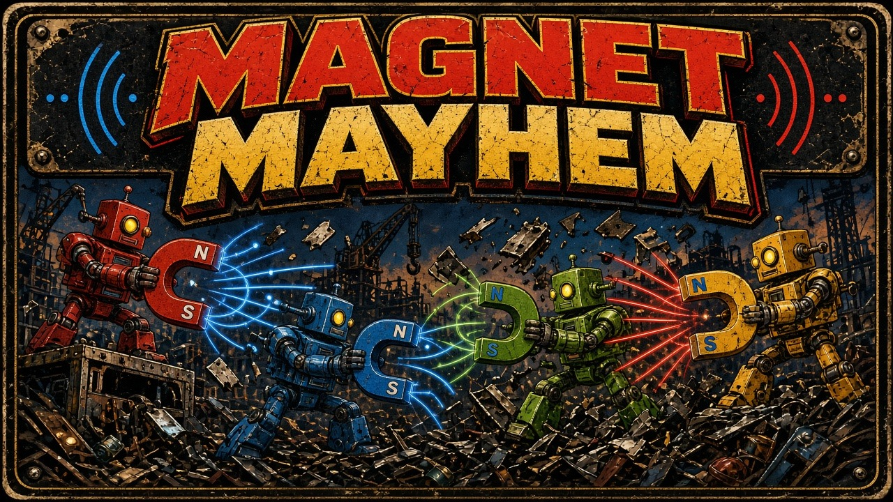

# Magnet Mayhem

Flip polarity to grab and fling scrap. Last bot standing.

Four robots share a top-down junkyard. Each one carries a magnet that is either red **+** or blue **−**. Opposite polarities pull. Matching polarities push. Hold action to catch up to three scraps in orbit, then release to fling them — or flip polarity and blast the orbit outward. Scrap hits hurt more the faster they fly. The arena edge is a crusher. First robot to take three rounds wins the match.

Everything runs in the browser: one HTML page, canvas, and the Web Audio API. No install, no account, no network play.

## Launch

The game is served locally so the ES modules load. Each launcher looks for Python 3 and tells you if it is missing.

| Platform | How |
| --- | --- |
| macOS | Double-click `launch-mac.command` |
| Windows | Double-click `launch-windows.bat` |
| Linux | `./launch-linux.sh` |
| Any | `python3 server.py` |

The server binds to `127.0.0.1:8815`. If that port is busy it tries the next free port and opens the page. Pass `--no-browser` to skip the browser, or `--port` to start somewhere else.

## Controls

Keyboard works with no gamepads. A connected pad (standard mapping, pads 0–3) takes over that seat and ignores its keys until it is unplugged. Plugging a pad in during a bot match takes the seat over immediately. Start or Esc pauses. M mutes. Remaps are saved in `localStorage`.

| | Move | Action (grab / fling) | Secondary (flip polarity) |
| --- | --- | --- | --- |
| P1 | W A S D | F | G |
| P2 | Arrow keys | `/` | `.` |
| P3 | I J K L | `;` | `'` |
| P4 | Numpad 8 4 5 6 | Numpad 0 | Numpad Enter |
| Gamepad | Left stick or D-pad | A | B |

On the title screen, Enter or Start continues. On the join screen, action claims a seat, secondary cycles bot / off, and Enter starts. Any seat you leave empty is a bot, so one person can play against three. At least two fighters are required.

## Rules

- Free-for-all. Four seats, one shared screen.
- Robots have 100 HP. A fast scrap hit deals damage from its speed, up to 58 from a single impact. Slow contact does nothing.
- Holding action pulls nearby opposite-polarity scrap into orbit, three pieces max. Releasing flings the orbit in the direction you are facing.
- Secondary flips +/−. If scrap is orbiting, the flip throws it out in a burst.
- Robots attract opposite-polarity scrap and other robots, and repel matching ones, inside a short radius.
- Touching the crusher wall deals continuous damage.
- Scrap respawns while the count is low.
- The last robot alive scores the round. If everyone drops on the same tick, the round is a draw.
- First to 3 rounds wins. Settings can change that to 1 or 5. The match screen shows standings, a rematch, and a way back to the title.

## Arcade manifest

`arcade.json` describes the cabinet: name, id `magnetmayhem`, icon, cover, per-OS launchers, the `index.html` entry, 4 players, minimum 1 (bots fill the rest), keyboard and gamepad input, port 8815, version 1.0.0.

## Tests

Core rules live in `src/core/` with no DOM, so they run under Node's built-in test runner. Nothing to install.

```bash
node --test tests/
python3 tests/server_smoke.py
```

The JavaScript suite covers movement and collision, magnet attract / repel, orbit, fling, polarity burst, scrap damage, crusher elimination, round and match scoring, bot matches, seeded RNG, keyboard and gamepad mapping, and `arcade.json`. The Python smoke test checks that `server.py` serves `index.html` and steps to the next port when its first choice is taken. GitHub Actions runs both.

## License

MIT. See [LICENSE](LICENSE).
